# Pokemon Essentials 69 张地图扫描与生成规则

> 扫描日期：2026-07-13。来源：Pokemon Essentials v21.1。69/69 个 `MapXXX.rxdata` 均成功解析和渲染。

## 关键结论

- 当前草地灯塔构图不成立：灯塔素材虽然完整，但小池塘不足以建立海岸语义。灯塔应位于连续海域中的近岸基座、礁石平台、岛屿或防波堤上。
- `Outside.png` 确实包含 `3941～3983` 的 3x6 白色灯塔模块，但 69 张示例地图中实际使用灯塔的地图数量为 **0**。因此灯塔位置必须从 Route 4、Route 6、Route 8、港口和岛屿的海岸规则推导。
- Essentials 的地图不是按装饰块随机铺设，而是先确定边界、入口/出口、主路线和功能节点，再用草丛、水域、森林、建筑及前景层填充剩余空间。
- 多出口地图保留所有有效路线；路线应共享入口侧主干，并保证每段道路通向出口、建筑门口或明确事件点。

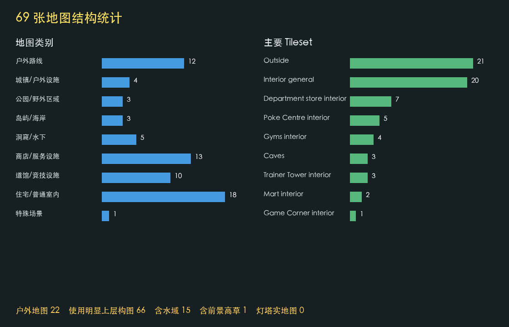

## 全量统计

- 地图总数：69
- 户外路线：12；城镇/户外设施：4；公园/野外区域：3；岛屿/海岸：3
- 洞窟/水下：5；普通室内：18；商店/服务设施：13；道馆/竞技设施：10
- 含水域：15；含森林边界：19；含 Layer 1 前景高草：1
- Tileset 使用量：Outside 21；Interior general 20；Department store interior 7；Poke Centre interior 5；Gyms interior 4；Caves 3；Trainer Tower interior 3；Mart interior 2；Game Corner interior 1；Dungeon cave 1；Underwater 1；Harbour interior 1

## 通用生成规则

### 1. 先画拓扑，再画景观

先确定入口、1～2 个出口、建筑门口、楼梯和事件点，再生成连接这些节点的主路线。剩余区域才分配草丛、水域、森林和装饰。不得先铺大面积道路，再反向寻找可走路线。

### 2. 边界必须有语义

户外地图通常用森林、悬崖、海洋、围栏或建筑连续封边，只在实际转场位置留下窄开口。屏幕边缘不能出现被截断的独立树顶、树根或半个建筑。

### 3. 多出口道路共享主干

多个出口可以同时存在，但路线应先共享入口侧主干，再在靠近出口处形成最短分支。每段道路必须通往入口、出口、门口或事件点；没有用途的道路属于浪费。道路宽度由玩法决定，StickMon 保持两格宽并允许精灵沿两格中线自由移动。

### 4. 地形必须形成连续区域

道路、草丛、水面和山壁使用完整边缘、转角、内部与收口组合。禁止把内部 tile 直接贴到普通草地，也不能用池塘模块冒充海洋。小水面使用池塘边缘；海岸使用 Sea deep -> Sea edge -> shore -> land 的连续过渡。

### 5. 草有两种高度语义

`390` 是 Layer 0 的普通可遇敌草；`391` 是 Map028 使用的 Layer 1 前景高草，具有 `priority=1` 和 `terrainTag=10`。高草应成片分布在道路两侧，不能盖住出口、道路、水面、灯塔或建筑门口。

### 6. 森林是多行模板

Map039 的森林由 Layer 2 树冠、Layer 1 栅栏、Layer 0 接缝行、树顶/树身对和根部组成。根部上一行必须是树身；位于地图底部时仍要保持完整序列，不能把树顶直接接根部。`800/801 -> 808/809 -> 818/819` 只是缺少树冠的森林片段，不是完整独立树；它只能作为从画面上方继续进入地图的连续边界，且顶行必须严格位于 `y=0`。地图内部、底部及左右边缘均禁止使用该片段。

### 7. 地标需要环境支撑

地标不应孤立摆放。建筑门口需要前庭和道路；喷泉需要广场；灯塔需要连续水域、海岸或堤岸；桥梁两端需要可达道路。地标周围应留出可识别轮廓和交互空间。

### 8. 建筑门口对齐道路

城镇建筑通常沿道路或广场布置，门口前至少留出 1～2 格净空。屋顶、招牌和树冠可进入上层，但碰撞仍由底层结构和 passage 决定。

### 9. 室内保持中央通道

住宅、商店和设施多采用矩形房间：墙体封边，家具沿墙或围绕功能区布置，入口到柜台、楼梯或事件点的中央通道保持畅通。竞技场和多层商店则使用明显的轴线与对称布局。

### 10. 洞窟按高度带组织

洞窟用连续岩壁带、台阶和窄口表达高度变化。岩石用于修整轮廓和控制通路宽度，不能随机散落到主路中央。楼梯必须连接两个可读的高度区域；楼梯所在的连续崖带必须保持同一高度，不得直接邻接另一段异高悬崖。

霜晶窟的首层入口与末层出口使用 `Caves.png` 的亮光模块 `1299/1300/1301`，按四个边界预生成旋转后的资源，顶部入口额外使用 180° 版本；洞穴内部停用 `1308`，层间只使用贴合岩壁的 `1332＋1340` 上行梯子与 `1333` 下行梯子，暂不生成 `1321 -> 1322` 的坠落路线。同一入口方向有四种路线变体，再按种子铺设雪地装饰。冰面 `1328` 使路线连续滑行。预览多层效果：`python tools/generate_frost_crystal_cave_preview.py --levels`。

运行时 v21 中，霜晶窟路线使用单格中心坐标，不沿用户外双格道路的半格偏移。干地路线用原版 `Caves.png` 的完整雪地通路图块拼接，运行时编号 `4780～4794` 与既有 `4501`；光滑冰面保留原图块和滑行规则，冰外才恢复雪路。停用随机 `4505` 反光，避免误认成可滑行冰面。按房间大小生成约 8～12 组装饰：冰晶优先分布在不同墙角、完整占位避开路线周围一格；小雪石可贴路边，优先与冰晶及墙脚组成疏密有别的小组。所有装饰避开真实冰面、分叉与入口/楼梯周围一格，冰晶 `4508/4509` 分别搭配上方 `4541/4543`，完整占位不得撞墙或遮住路线。雪墙 `4512～4523` 按角色脚底深度恢复遮挡，两个冰晶图块共用底座深度；队首、伙伴、头目按相同规则排序。新增资源只追加 Kind，不移动旧编号；地图包现为 279 帧，固件与生成器的单包上限同步为 288。

### 11. 三层图块语义不能互换

Layer 0 放地面和主体；Layer 1 放高草、围栏、建筑与可遮挡结构；Layer 2 放树冠、屋檐和更高前景。`passages`、`priorities`、`terrainTags` 必须随原 tile 保留。

### 12. StickMon 的裁图规则

先在更大的逻辑地图上生成完整拓扑，再选择 16x12 格镜头区域。镜头内必须同时看见当前位置、至少一段前进方向和一个景观锚点；不要为了塞满屏幕而截断树、建筑或海岸过渡。

## 代表性地图

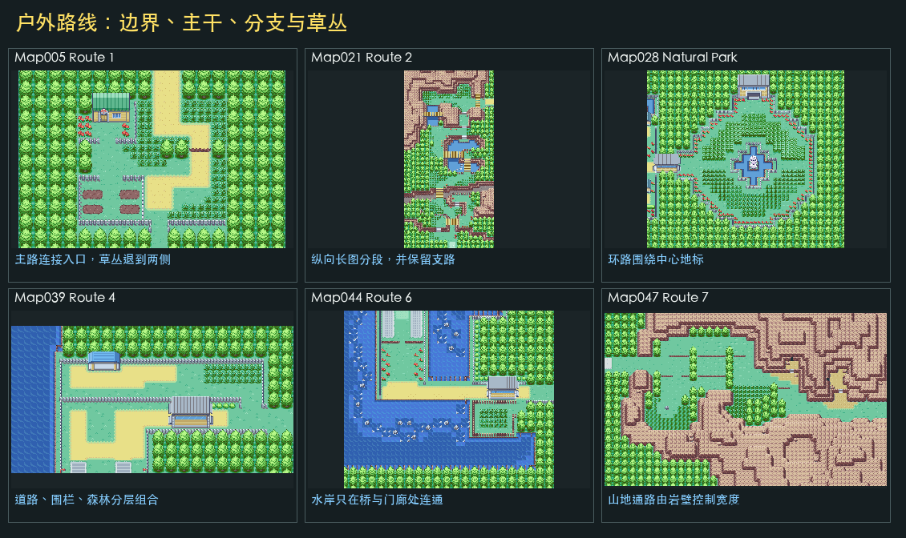

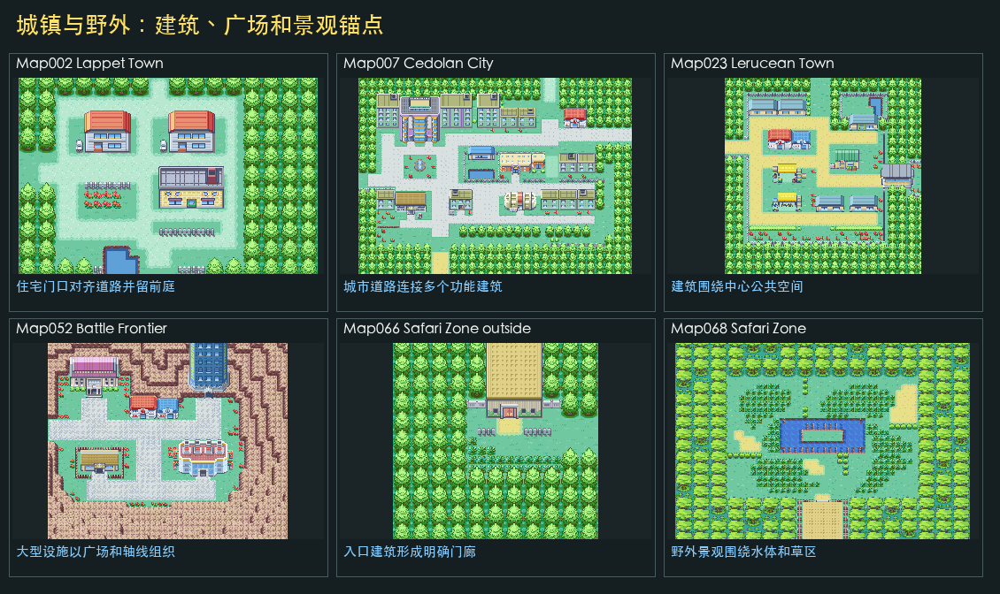

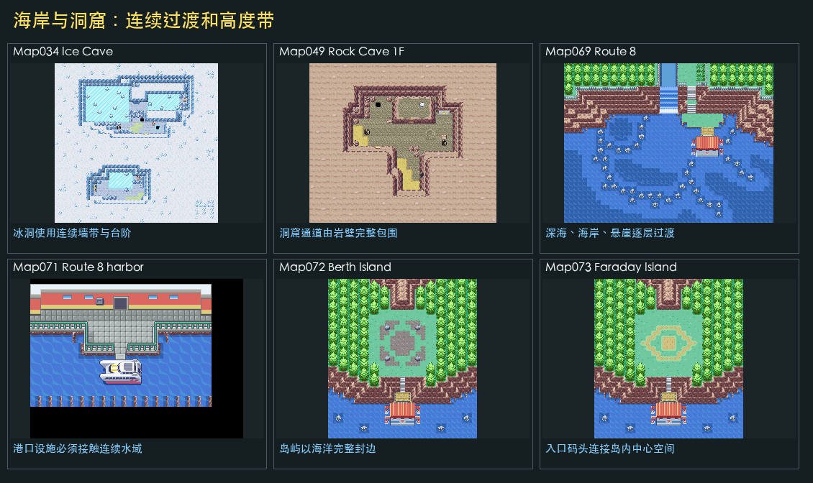

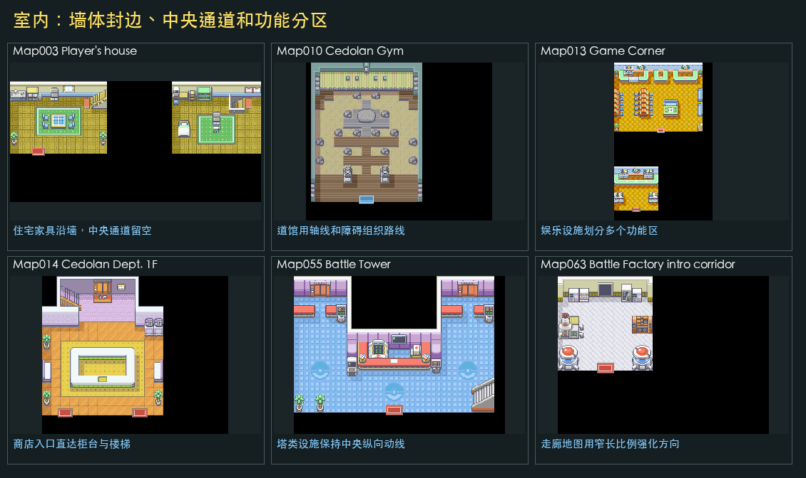

## 应用到 StickMon：溪流、桥梁与坡壁

### 溪流主体

- 竖向溪流使用 `Outside.png` 的左岸 `1096`、水面 `1097` 和右岸 `1098`，最小宽度为 3 格。
- 溪流可以保持直线，也可分段变宽或变窄；禁止在宽度不变时只横向平移整条水道。
- 每个分段边界上，单侧河岸最多移动 1 格。更大的宽度变化必须拆成多个渐进分段。

### 岸角拼接

- 溪流变宽或变窄时不能用草地直接截断竖直岸线，每一侧必须使用“外角 + 内角”两个 tile 连续收口。
- 向屏幕下方变宽使用 Essentials 原生上岸角：外角 `1088/1090`，内角 `1104/1106`。
- 向屏幕下方收窄使用上述岸角的纵向翻转派生 tile `4400～4403`，保留相同泥土质感，并继承原 tile 的 `passages`、`priorities` 和 `terrainTags=6`。

### 桥梁、石块与语义

- 桥面覆盖行及其上下各 2 格是直流缓冲区：溪流的左岸位置和宽度必须保持不变，转折、变宽和变窄都不能发生在桥下或桥边。
- 横桥只承载水平方向直行。桥端必须至少落到 1 格完整陆地平台，分叉、直角转向和上下楼梯均应从桥外的陆地格开始；不得把桥面延伸到转向格，否则桥 tile 的方向 passage 会产生视觉可走但语义阻挡的无效路线边。
- 水中石块必须完全位于水面中，不得覆盖桥梁或路线。所有溪岸转角格及其周围 1 格均为石块禁放区，避免高层石块帧遮挡泥土岸角。
- 桥面是陆地通行面；普通溪水保持水面和漂浮通行语义；水中石块同时阻挡陆地与漂浮移动。

### 坡壁与楼梯

- 溪桥坡使用 `Outside.png` 原素材两行崖面：上行中段 `1188` 放在 Layer 0，下行中段 `1185` 放在 Layer 1。原版 Map021 Route 2 的第 28、29 行存在这一配套拼法；旧文档“不可上下配套”的判断已纠正。
- 上层台地向顶部和一侧屏外延伸，另一侧使用原图 `1176/1178` 侧壁；侧壁与正面交接使用 `1187/1189`，下行收口使用 `1184/1186`。透明图块叠在普通草地上，不能通过翻转、拉伸、重绘补齐素材。
- 两格宽楼梯 `1161/1162` 在上下两行连续铺设，左右至少各有一格同高崖肩。楼梯上方和下方各有两行直行道路，下层路线在完整落脚区之后再转向桥头。
- 随机路网与台地一起生成：台地侧壁、两行正面以及楼梯均纳入地形占位；与道路的交集必须恰好为楼梯四格。崖壁不能覆盖河道或桥梁，植被不能覆盖崖壁或楼梯净空。

### v23 洞穴子图的生成顺序（现作为区域 5 的保留分支）

- 运行时算法 v19 的区域编号 `1` 为“溪桥坡地”。使用独立的 `seed ^ 0x91E10DA5` 随机流等概率选择 A 开阔直溪、B 繁茂展宽、C 缓弯双岸、D 坡脚河湾。风格是生成规则，不是固定地图模板；入口、真实分叉点、两个出口、桥位、河道与植被坐标均按种子变化。
- A 保持直流与开阔留白；B 有一次变宽或变窄；C 通过相隔至少两行的两次宽度变化形成错位，两端宽度相同；D 在局部展宽后回到原水道，并必须有完整台地和两行楼梯。河宽为 3～5 格，每次仅一岸变化 1 格，桥区仍遵守直流缓冲与完整陆地桥头约束。
- A 不生成台地；B/C 分别按 25%/45% 的独立种子随机决定是否生成台地，D 必须有台地。有台地时使用专用上下层路网，随机选择左右岸、台地宽度与高度、楼梯横坐标以及桥位；无台地时保留通用路网。
- 每个候选先尝试至多 96 个确定性路网/桥位组合，仅选择满足风格与道路约束的河道。若两岸不能各容纳至少 4 格独立草丛，整个候选重试，最多 16 个候选；重试保留种子与已选风格。全部尝试仍不合法时返回生成失败，不以另一种风格代替。
- 地形按“普通地面 -> 溪流与岸角 -> 桥梁 -> 悬崖与楼梯 -> 水中石块 -> 道路 -> 完整树木/草丛/鲜花/灌木”合成。道路不得覆盖水面或崖面，路径落入水面时必须位于桥面，路径落入崖带时必须位于楼梯。
- 植被在两岸分别生长为主、次草丛，使用紧凑度、岸距、边缘留白和随机扰动控制形状；桥头、岔路、楼梯周围各留一格净空。A～D 草量目标分别为 18～21、24～27、22～25、20～23 格，空间受限时保留空地。B/D 尝试放置一棵完整的原素材 2×3 树，C 有一半概率尝试，A 不放树；花簇与间隔灌木沿草丛边缘分布。沿用原图块及现有岸角；新增四帧仅从原图直接裁取，不生成美术资源。
- D 河湾的展宽段必须持续 3～4 行，允许转折距地图顶部或底部仅一行；桥边直流缓冲不变。空间不够时重新选择候选，不能把河湾压缩为两行凸块。
- 两岸草丛都必须有完整的 2×2 核心，外接宽高均至少两格，长边不超过短边两倍；次草丛最多 9 格、宽不超过 3 格、高不超过 4 格。紧凑生长重试仍无合格草丛时重选布局，禁止退回沿岸细长条。
- 完整树木与坡壁、楼梯之间至少留一格净空。楼梯上下各两格的路线必须沿同一列直行，不能在下楼一格后立即转弯；两格宽道路也必须覆盖完整上下平台。
- 拓扑、地表和溪流特征使用独立 XorShift32 随机流；C++ 与 Python 必须共享候选枚举顺序、随机数调用顺序、算法版本和 FNV 指纹。同一 `seed + entryEdge + areaIndex` 必须生成完全相同的三层 tile 数据。

## 应用到 StickMon：古木瀑谷的动画水面与瀑布

### Map069 autotile 槽位

- 参考地图固定为 Map069 Route 8，`autotileNames` 顺序必须是 `Sea`、`Sea without shore`、`Sea deep`、`Sand shore`、`Waterfall crest`、`Waterfall`、`Waterfall bottom`。改变顺序会让相同 tile ID 映射到错误资源。
- `Sea.png`、`Sea without shore.png`、`Sea deep.png` 和 `Sand shore.png` 均为 `768x128`，即 8 个 `96x128` 的 RPG Maker XP autotile 动画帧。
- `Waterfall crest.png`、`Waterfall.png` 和 `Waterfall bottom.png` 均为 `128x32`，即 4 个 `32x32` 动画帧。

### Sea 水面与岸线

以下为旧直流水道规则；区域 5 当前采用文末“运行时生成顺序”所述 v23 原岸线组合，
透明区衬底改为洞窟地面，不再使用草地 `385`。

- 古木瀑谷上下游统一使用 `Sea` 槽位 `48～95`，保留 `terrainTag=7` 和漂浮水面语义；禁止再使用无动画的 `1096/1097/1098` 静态溪流块。
- 直流水道使用中心水面 `48`、左岸 `64`、右岸 `72`。水道从地图顶部进入时保持左右岸连续，不在 `y=0` 增加横向封口。
- 瀑底扩宽水潭的第一行必须声明 `top_open_spans`：瀑布正下方继续使用水面 `48`；水潭最左侧使用左上岸角 `84`，最右侧使用右上岸角 `80`；两个落水口之间没有瀑布覆盖的格使用连续上岸 `68`。第二行起恢复 `64 -> 48 -> 72` 的左右岸结构。
- `84/80` 的外侧角包含透明像素，不能直接放在没有底图的 Layer 0，否则透明区会露出黑色画布。生成器必须先在 Layer 0 放普通草地 `385`，再把这两个岸角放入 Layer 1；水域碰撞与 `terrainTag=7` 仍由上层 Sea 岸角提供。
- 圆角处出现的黑点不是新的岸线 tile，而是 `84/80` 的透明像素读到了值为 `0` 的空图层。修复时禁止涂改或裁切原 Sea 帧；C++、Python 和预生成地图都必须保持“同一格 Layer 0=`385`、Layer 1=`84/80`”的双层结构。回归测试必须枚举 Layer 1 的每个 `84/80`，确认同索引 Layer 0 为 `385`，并检查瀑底两个外角均存在。
- `Sea without shore` 槽位 `96～143` 同样有 8 帧波动，但不提供与陆地接触所需的泥岸轮廓，只能用于完全被其他岸线包围的水面内部，不能直接贴草地或悬崖。

### 瀑布拼接与语义

- 瀑布顶使用 `240～287`，当前横向模板为左 `283`、中 `273`、右 `285`；瀑布主体使用 `288～335`，按顶部 `322/308/324`、中段 `304/288/312`、下段 `328/316/326` 排列；瀑布底使用 `336～383`，当前整行使用 `336`。
- 瀑布宽度至少 3 格，结构顺序固定为“上游 Sea 水面 -> 1 行瀑布顶 -> 瀑身 -> 1 行瀑布底 -> 下游 Sea 水面”。古瀑谷 v23 经确认的短瀑允许 1 行瀑身，其余模块为 2／3 行。瀑布缺口不得被悬崖回填，水中石块不得覆盖瀑布或落水口岸角。
- 瀑布顶保持 `terrainTag=9`，瀑身和瀑底保持 `terrainTag=8`。它们属于水域但普通漂浮不能通过；下游 `Sea` 水面保持可漂浮。

#### 2026-10-24 补充：完整上下游瀑布的落水衔接

以下是 A/B/C 多房间桥洞预览中确认的规则，适用于画面内同时呈现上下游的瀑布。
落水衔接始于 v3，当前确认版证据位于 `.stick-local/previews/valley-light-decor-v7-20261024/`，
包含三房间图层、路线和八帧动画检查；峡谷岸壁以本文下节规则为准。
本节约束已用于运行时 v24 的高桥 A/B/C；原 v23 四图继续保留。
不适用于上游在屏外的“瀑海群岛”截断瀑布。

- 先声明高处上游、崖面缺口、瀑布顶／身／底和低处承接水潭，再生成岸线；
  不得先把水潭封成独立池塘，再把瀑布贴在池塘上方。
- 设瀑顶行为 `c`、瀑身高为 `h`，则瀑身占 `c+1..c+h`，落水泡沫行为
  `s=c+h+1`。承接水潭的水域遮罩必须包含泡沫整行的宽度，且该行左右各至少
  延伸一格水；下一行在瀑布全宽内仍必须是水，不能夹入干岸、岩石或崖面。
- 计算承接潭岸线时，瀑身末行和泡沫行属于相邻水体上下文，不能被当作北侧陆地。
  泡沫下一行的上半部必须使用开放水面四分块（当前 Sea 为 `26/27`），
  禁止自动补出横向北岸。上下游仍分别保留高度语义，不能为修图而合并成同层水池。
- 绘制顺序为洞穴地面衬底、承接潭水面、原瀑顶／身／底；岸角透明区必须有底图，
  不得用涂色或遮盖条消除接缝。水面到泡沫之间不允许出现一条横向棕色干岸。
- 瀑布必须落在连续崖面的缺口中；左右两侧使用一致的崖顶／崖脚高度，
  不能成为悬空水帘。当前确认版 A 的桥跨越平坦上游，落差从桥下游开始，
  桥面不能横压瀑身；“桥在瀑布上游”是本布局约束，不是所有河流地图的通则。
- 上游直岸 `Outside:1136/1138` 与瀑顶弯岸唇 `1144/1146` 按原 Map069 模块衔接；
  它们是水边轮廓，不能替代洞穴岩台侧壁。河岸侧壁必须另按高地所在方向选块，
  不能只按“水的左边／右边”套用岛体左缘／右缘。
- 只使用原素材完整图块或有来源记录的完整四分块组合，不生成或补绘资源。
  验收所有瀑布的落水行及下一行，并检查 8 帧动画：Sea 用 `i`、瀑布三段用
  `i % 4`、每帧 `140ms`；静态首帧通过不能替代完整动画检查。

河岸朝向的具体错误与原版对照见 [Caves 地形块语义](Caves地形块语义.md#洞穴河谷两岸与高地朝向)。

#### 2026-10-24 确认：峡谷两岸与原结构保留

适用于 A/B/C 多房间桥洞中、两侧洞穴干地夹着河道的峡谷直岸。
以用户确认的 v6 岸壁、v7 少量装饰版为准；已接入运行时 v24 的高桥 A/B/C。
以下左右均指画面左右，编号均为原图块编号，不是运行时资源 Kind。

| 部位 | 原素材 | 图层与衔接 |
| --- | --- | --- |
| 画面左岸岩壁 | `Caves:590` | Layer 1；透明部分朝左侧外部干地 |
| 画面右岸岩壁 | `Caves:588` | Layer 1；透明部分朝右侧外部干地 |
| 岸壁底图 | `Caves:610` | Layer 0；保留原洞穴地面，让岸壁透明部分露出干地 |
| 河道细水岸 | `Outside:1136/1138` | 左／右水边轮廓，独立于洞穴岩壁 |
| 瀑顶弯岸唇 | `Outside:1144/1146` | 与细水岸、瀑顶按原 Map069 模块连接 |

- 岩壁使用上述原朝向，不再次互换、不镜像、不旋转或补绘。不能因为这两块也出现在
  环状边缘模块中，就按岛体“左缘／右缘”的位置直接套到河流两岸。
- 透明部分在本方案中朝外侧干地，因此衬底必须保留 `610`；不能改成水面，
  也不需要把整个上层地面换成浅色 `513`。`504～522` 抬高岩岛模块及其 Sea 衬底
  规则属于另一种场景，不能移用到这里。细水岸不能代替岩壁，高低差仍由岩壁表达。
- 当前验证过的直段上端接原北洞壁，下端接桥头与前侧崖面。变更直段长度或增加转弯时，
  必须重新检查端点与原素材转角，不将本次三格直段当作任意轮廓的完整拼接模板。

确认版 A 为 16×12，以下坐标从 0 开始，作为维护时的对照，不是所有地图的固定坐标：

- 左／右岩壁分别位于 `x=8/12, y=2..4`；上游河道为 `x=9..11, y=2..5`。
  相对原 v3，岸壁修复仅替换这六格；北洞壁、洞穴地面和原有水路结构保留。
- 桥为 `x=8..12, y=5`，五格原流星瀑布木桥覆盖两岸边缘与上游平水面。
  前侧崖面位于 `x=1..8` 与 `x=12..14`，上排 `y=6` 用 `Caves:521`，
  下排 `y=7` 用 `529`；中间保留瀑布缺口。
- 瀑布宽为 `x=9..11`，顶／身／泡沫分别在 `y=6/7/8`，
  承接潭为 `x=8..12, y=8..10`。保留封闭承接潭，不改成向屏底出流的河道，
  不新增从北洞壁入流的开口。119 号道路只用于参考河岸层次，未采用其整体水路拓扑。
- 行走顺序保留为“A 下层 → B 下层 → B 楼梯登高 → A 上层过桥 → C 上层 →
  C 楼梯下行 → C 下层出口”。A 下层不能直接登桥，也不安排从桥下经过。

装饰保持少量成组：沿墙脚、已有岩石和潭边追加原 `557/558/566`，避开主路、桥头、
楼梯与洞口接近区。凹坑必须完整拼接 `542/543` 与下一行 `550/551` 的 2×2 模块，
本版置于 A 的 `(4,2)`，放在 Layer 2、下衬 `610`；完整占地预留，不能拆散随机撒放。
A 下层黄色地面斑块缩为 2×2，保留周围洞穴底色；装饰不改变水路、高程或房间互通。

验收须覆盖岸壁朝向、透明衬底、桥头／崖面接缝、泡沫下一行开放水面，以及 8 帧动画。
v7 的 `manifest.json` 已记录相对 v6 的结构层、路线与洞口不变，装饰避开路线和接近区，
B 登高／C 下行必经及三处落水衔接检查。预览中 `6000 + Caves 原编号`（如 `6590/6588/6610`）
及 `10000 + Outside 原编号` 都是本地别名，不能直接写入正式地图资源表。
外观已获用户确认；v24 接入后已单独验证桥面高程、角色遮挡与路线脚部。设备观感仍待实机确认，
不能以本地预览或 host 通过代替实机验收。

#### 2026-10-25 随机候选：四套峡谷桥洞骨架

`tools/valley_bridge_layouts.py` 在 v7 已确认的岸壁、瀑布与三房间关系上增加成组随机设计；
v8 随机候选保留 v7 岸壁／装饰原则；2026-10-25 已按用户要求接入正式 C++ 生成器和资源包。
固件取四种结构各四组验证配方，共 16 套 A/B/C；Python 候选生成器的完整随机范围较大，
不要把两者混称。森林六型与原山洞四型同时保留，详见 `doc/古瀑谷布局与瀑布衔接.md`。
`tools/preview_valley_bridge_layouts.py` 只向 `.stick-local/` 输出预览。

| 骨架 | A 河道列 | 桥行 | 瀑身高度 | B 楼梯列 | C 楼梯列 |
| --- | --- | --- | --- | --- | --- |
| 东岸短桥 | `9..11` | `5` | `1` | `7` | `10` |
| 中峡高瀑 | `7..9` | `4` | `2` | `10` | `9` |
| 东峡宽桥 | `9..12` | `5` | `1` | `11` | `9` |
| 西峡绕岸 | `6..8` | `4` | `1` | `8` | `11` |

- 坐标从 0 开始。A/B/C 同种子整组生成，种子按 32 位归一化；返回任何房间必须复现同组数据。
  洞口位置与高程成对匹配，B 登高、回 A 过桥、C 下行的通关关系不变。
- A 的岸壁依旧左 `590`／右 `588`、下衬 `610`，桥覆盖两侧岸缘，落差在桥的下游。
  封闭承接潭保持泡沫行及其两侧、下一行完整开放，只在更下方的潭底角调整收口。
- 种子另控制 B 上层绕行、B/C 支路、潭底角、成组岩石、完整 2×2 凹坑与地面斑块。
  装饰预留主路及其邻格、洞口两格接近区、楼梯和桥头；凹坑保留完整四格，禁止拆散撒放。
- 除干地可达性外，还检查每层已声明路线自身连通，支路必须接到同层路线，楼梯两端分别
  接上下层路线；枚举途中脚部采样，防止只验证格心却在移动时擦入岩壁或水中。
- 验证入口为 `tools/test_valley_bridge_layouts.py`。预览证据位于
  `.stick-local/previews/valley-bridge-random-v8-20261025/`，包含四种子整组图、路线图、
  八帧动画及同一骨架不同种子的对照；完整 JSON 保存全部图层与素材编号。

### 动画导出

- Python 预览按 8 帧全局循环：Sea 使用第 `i` 帧，瀑布三段使用第 `i % 4` 帧，当前每帧 `140 ms`。PNG 只保存首帧，GIF 用于检查岸线和水流动画连续性。
- C++ 运行时同步时必须保留相同帧索引规则，不能把 8 帧资源提前压成单张静态 tile。

### 截图参考的瀑海群岛

这是独立的水面岩岛候选方案，以下 `512/514`、`513` 岛面和 Sea 衬底仍只适用于岩岛模块，
不替代上节已确认的峡谷两岸规则，也不是已接入运行时 v23 的四布局。

- “瀑海群岛”采用水面优先拓扑：Layer 0 先铺满 8 帧 Sea 中心水面 `48`，再叠加屏顶大瀑布、岩岛和桥。瀑布有三类方向模板：`left=0` 的左入瀑、`left+width=16` 的右入瀑，以及 `left=0,width=16` 的全宽瀑布；瀑身高度允许 2、3、4 格。左入瀑从右侧可见崖边到地图右边界整块填充不可通行洞穴悬崖，右入瀑镜像处理；该矩形内包括紧贴瀑布的一列、屏幕最外列和最底行在内，每格都必须是悬崖块，并按左缘 `576`、中部 `577`、右缘 `578` 组成一个连续崖面，不得机械重复边缘，也不得混入岸侧块 `512/514` 或底缘收口块 `520/521/522`。全宽瀑布不生成侧壁或悬崖填充。禁止以可站立岛面代替悬崖，也禁止在开放水面中只留一列孤立岩壁。画面内不放瀑布顶、上游水池或封闭落水潭，瀑布底与最近下游岩岛之间至少保留两整行 Sea，不能用岩岛承接瀑布。
- 瀑布下方以及岩岛周围的全部 Sea 必须形成一个四向连通水域。生成器需要对全部 `water_cells` 做洪泛检查，禁止瀑布侧壁、触边岛屿或长岩墙把水面切成互不连通的水池。水面仍保留 `terrainTag=7`、8 帧波动和未来漂浮通行语义。
- 岩岛使用 Map049/Caves 的抬高平台结构：顶边 `504/505/506`，左右侧壁 `512/514`，底边 `520/521/522`，内部统一显示浅色岛面 `513`。路线只保留在 `road_cells` 语义中，不得再用 `610` 绘制可见道路。因原始 `513` 的 passage 为全向阻挡，Python 预览 ID `4603` 取 `Caves:513` 的像素、复制 `Caves:610` 的 passage/priority/terrainTag，兼顾统一岛面和路线通行。每张图至少放置两个彼此分离的岩岛；岛缘绘制在 Layer 1，Layer 0 必须保留 Sea `48` 作为透明像素衬底，使四个圆角露出水面，不得铺 `513` 或其他地面。本场景禁止使用 Sea 岸角 `84/80`，也不生成封闭 `cave_basins`。
- 入口与每个出口都通过岩岛自身延伸出屏实现，禁止附加门框。`extend_left/right/top/bottom_to_edge` 只能在岛体确实接触对应地图边界时启用；启用后取消该方向的侧壁，边界上的内部格继续使用浅色可通行岛面。与延伸方向垂直的岛缘仍保留到屏幕边界，并使用中段 `505/521` 或 `512/514`，不绘制表示岛体终止的角块。所有位于屏幕边界的路线格必须同时属于 `land_cells`，不得落入 Sea 或 cliff。
- 单侧瀑布旁的悬崖填充整体属于 `cliff_cells`，不得生成 `land_cells`、装饰岩柱或可站立高台。`576/577/578` 本身形成连续悬垂岩纹，不再额外叠加 `557～567` 地面岩柱模块。
- Caves 块的人工确认用途统一记录在 `doc/essentials_map_analysis/Caves地形块语义.md`。边界出入口可用岛面直接延伸、山洞口、岩石台阶或梯子表达；同一组候选图中只在 1～2 张使用梯子，保留其他出入口作为视觉对照。
- `541` 下行梯口仍叠加在 Layer 0 的中心 `610` 上，但 3x3 模块顶部必须按环境选型：顶部紧接小岛或岩石块边缘时使用 `601/602/603`；其余情况使用 `617/618/619` 的 Y 轴镜像。中排保持 `609/610/611`，底排保持 `617/618/619`。九格必须全部属于 `land_cells` 且不与水面、悬崖或桥相交，中心必须属于 `road_cells`，模块轮廓必须接触声明的边界出入口；禁止单独生成 `541`。现有 `4610/4611/4612` 和候选地图仍是旧的固定顶排方案，本次只登记新语义，待视觉确认后再添加镜像别名、更新生成器并重新导图。
- 岛间桥使用 Outside 的横桥 `1627/1635/1643`，在 Caves 预览中映射为混合来源 ID `4600/4601/4602`。桥必须跨过至少一个真实水格，两端落到不同岩岛，并覆盖岛缘至岛面；路线与水面或岛缘的交集只能是桥格。桥只承载水平直行，分叉、直角转向和上下出口必须退回岛面，否则桥上下边的方向阻挡会产生无效路线边。
- 每张图必须同时导出首帧 PNG、8 帧 GIF、路线图和语义图。四张回归图必须覆盖左入、右入、全宽三类瀑布与 2/3/4 三种瀑身高度。其余回归要求为全部边界路线格属于出屏岩岛面、不得出现预览门框 ID `4604～4607`、全部水格同属一个连通分量、瀑布底下一格仍为水、岛缘底层均为 Sea、单侧瀑布悬崖全部属于 cliff 并填至对应边界、岩岛与瀑布不重叠、至少存在一段 `bridge & route & water`、`invalidRouteEdges=0`。该场景当前仅作为 Python 候选图，在选定前不将 Caves 岩岛、悬崖或混合桥面帧写入运行时地图包。

### 运行时生成顺序

- v23 曾将区域编号 `5` 直接映射为古瀑谷四洞穴，上／右／下／左入口分别选择 D 高低双台／C 弯岸瀑潭／A 折线台地／B 双瀑夹道。v24 起正式区域从森林 A 进入，森林 E 通这四个洞穴，森林 F 通高桥 A/B/C；不能再把四洞穴入口方向表当作整个区域的首图规则。保留洞穴本身地形固定，各有真实分叉和两个洞口出口。洞穴路线使用格心坐标，不强制两格宽。
- 三层由 `tools/ancient_valley_layouts.json` 生成：Layer 0 原 Caves 地面，Layer 1 原洞壁／楼梯与上下游水面／瀑布，Layer 2 原直岸／弯岸唇／南洞口前沿／岩石。Caves 新别名为 `4800～4835`，Outside `1136/1138/1144/1146` 为 `4840～4843`，八帧水岸组合为 `5000～5013`。透明岸角下保留洞窟地面。路线不得穿水或崖面，楼梯仅纵向经过；洞口终点原地退出过场。完整素材与验证见 `doc/古瀑谷布局与瀑布衔接.md`。
- 固件按 `millis / 140` 得到 8 帧全局索引；Sea 使用完整索引，瀑布使用 `index % 4`。Python 与 C++ 的三层 tile、结构标记和 FNV 指纹必须保持一致。

### 顶部森林片段

- `top_edge_forest_clusters` 仅用于表现从地图上方继续延伸的森林边界，生成器强制其顶行为 `y=0`。当前三行使用 `800/801`、`808/809`、`818/819`，缺失的树冠必须位于视口之外。
- 该片段禁止出现在地图底部、内部，或作为脱离顶部的左右侧边模块。允许从 `y=0` 延伸到左上/右上角，因为截断方向仍然是画面上方；底部和内部需要森林时，必须使用带 Layer 2 `804/805` 树冠、Layer 0 接缝/树身/根部的完整 `stamp_forest_fence` 模板，或使用另行验证过的完整独立树模板；空间不足时改用整块草丛、花簇、灌木或岩石。

## 2026-10-25 补充：雾林径 v25 正式接入

本节对应区域 `4` 雾林径，替代该区域旧围栏森林生成逻辑。区域 `5` 古瀑谷的六森林、四洞穴和高桥保持 v24 方案；全局算法版本升为 25 不代表其他区域地形重画。

### 样式与行程

- 七种样式依次为：林缘岔路、夹林曲径、混交回环、林间草甸、宽冠深林、树冠隧道、深林分岔。前段圆冠树与针叶树为主，中段混交，后段宽冠树为主。
- 原探索长度仍为 6～8 段。按从 1 开始的样式编号，6 段使用 `1/2/3/4/5/7`，7 段使用 `1/2/3/4/5/6/7`，8 段使用 `1/2/3/4/5/5/6/7`。第 6 段在 6／8 段行程中有专用入口衔接表，保证跳过或重复样式后边界道路仍对齐。
- 支持上、右、下、左四种进入方向；道路按方向重新布局，树木仍保持正立，禁止旋转整张图或树木素材。主路线连续，混交回环提供两条可选路线；未连接主干两端的短支路作为景观和环境精灵活动空间，不作为地图出口。
- 每种样式固定两组细节配方（设计种子 38、91），由地图种子的 `(seed >> 8) & 1` 选择。实际地图由种子、入口方向、区域、行程段号和总段数共同确定；这是有限配方池，不是每个种子独有的无限随机地形。

### 成片植被与原素材

- 普通草 `390` 每片 4～9 格，鲜花每片 3～6 格，长草每片 3～5 株。每片四向连通、轮廓紧凑而不规则，同类相邻片留间隔；空间不足时舍弃整片，不能退化为零星散点。
- 长草每株完整占两格：上格 Layer 1=`391`，下格 Layer 0=`399`。整株占地参与避让和连通检查，不可只放草尖。
- 所有草／花／长草片避开道路与树根，花不覆盖路面；树冠可以遮挡道路，树根不能阻断主路线。每片花保持一种主色，林缘红花、其余白花。花的透明像素下面保留原草地，禁止用空底替换造成黑洞。
- 所有像素来自 Essentials `Graphics`：树木／草／灌木／石头取自 `Tilesets/Outside.png`，鲜花取自 `Autotiles/Flowers1.png` 与 `Flowers2.png`，幼树取自 `Characters/Object tree 1.png`，橙橙果树取自 `Characters/berrytree_ORANBERRY.png`。仅原图块裁取、组合及现有资源管线缩放／量化，不生成或重绘美术。

### 运行时图层与维护

- 普通地面和花草底图放 Layer 0；树、幼树、果树和长草上半部放 Layer 1。树冠碎片记录所属整棵树的地面锚点，角色脚底处于树后时恢复相应遮挡，走到树前时不盖住角色；不能按每块树冠自身底边分别排序。
- 草坪拨动继续复用 `ExploreGrass` 对 `390/391/399` 的接触／回弹逻辑；环境精灵接触同样生效。鲜花组合块标记为草地栖息面，不因此宣称鲜花也有单独动画。
- 维护源为 `tools/mist_forest_layouts.py`，预览工具为 `tools/preview_mist_forest_progression.py`。执行 `python3 tools/mist_forest.py` 更新 `src/game/ExploreMistForestData.h`，再执行 `python3 tools/generate_game_assets.py --only map` 更新地图包；Python 和 C++ 消费相同表并核对指纹。
- 共 56 个基础方向配方、16 个行程衔接配方；152 条语义记录复用既有图像并新增 75 帧。原 774 个 Kind 编号保持，地图包现为 715 帧／3180 palette words／47534 B，应用和地图资源需同步更新。
- 验证覆盖已确认七图原像素、1792 组设计约束、588 组 Python／C++ 指纹、原生资源绘制与遮挡／草坪反馈，以及 Stick、OSTB、AMOLED 的完整 6／7／8 段行程。证据位于 `.stick-local/artifacts/mist-forest-integration-20261025/`；未刷机，实机观感与性能待验收。

## 应用到 StickMon：灯塔海岸修正

修正版不再使用错误的 `392～410` 空地图块。地图左侧按 Map039 的深海、深海边缘、近岸和陆地顺序构造连续海岸，灯塔基座位于近岸水中，道路与草地留在陆地侧。小型封闭水池另用 Map028 的 `1088～1106` 岩岸静水模块；禁止仅修改 passage/terrainTag 把视觉空地伪装成水面。

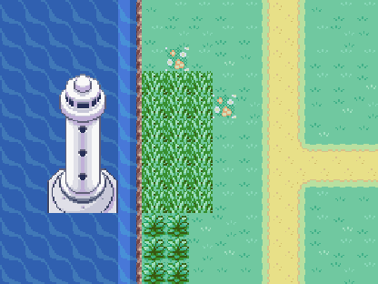

## 图层证据

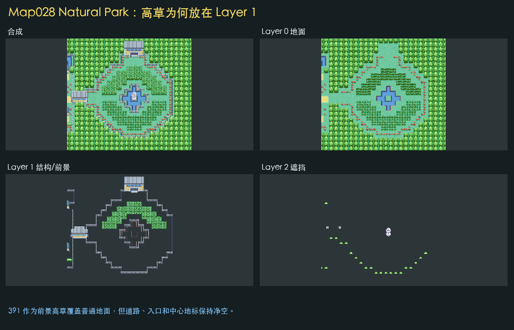

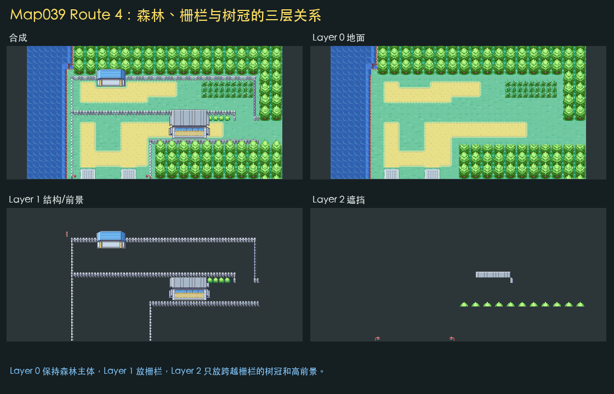

## 全部地图图册

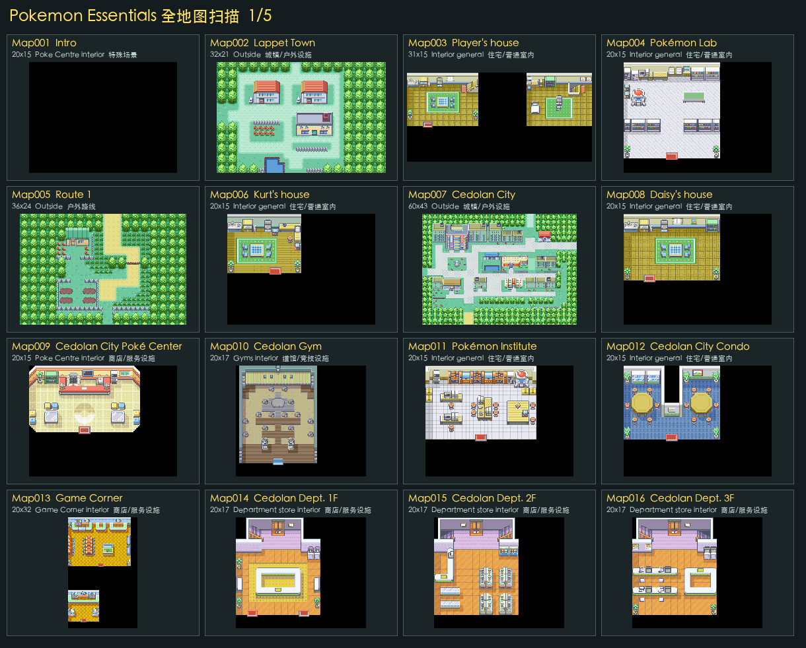

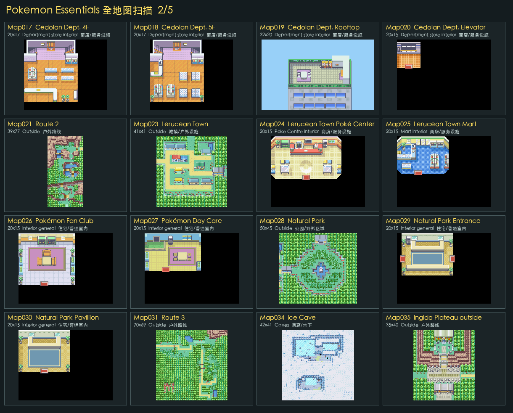

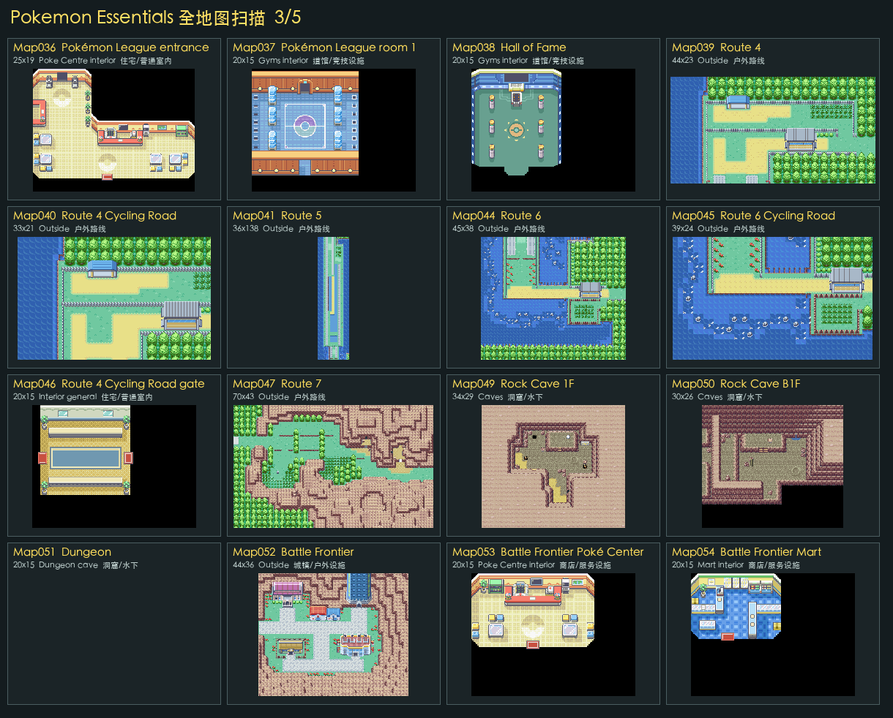

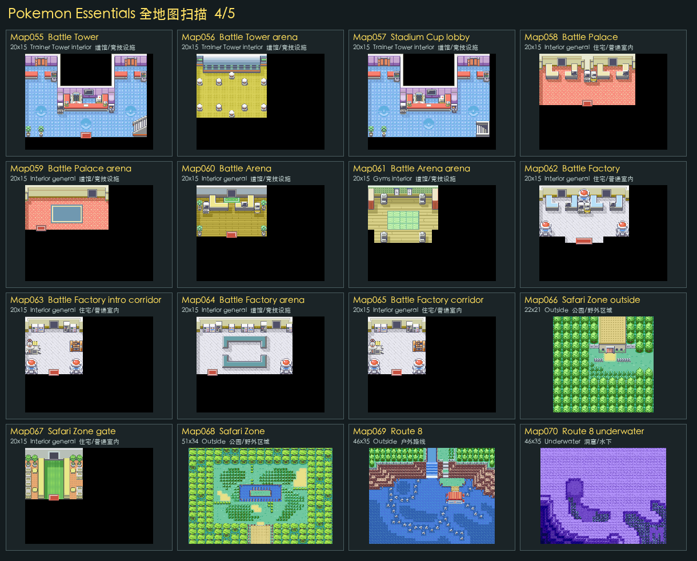

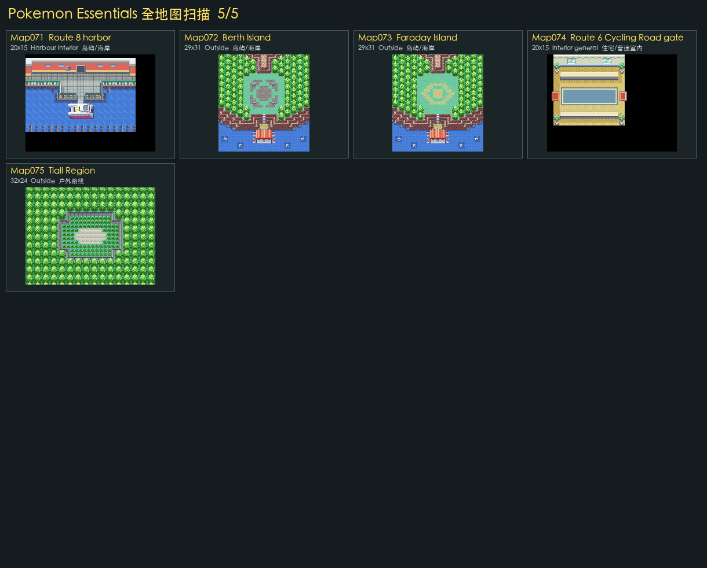

## 逐图索引

| ID | 名称 | 类别 | 尺寸 | Tileset | 事件 | L1/L2覆盖 | 特征 |
|---:|---|---|---:|---|---:|---:|---|
| 001 | Intro | 特殊场景 | 20x15 | Poke Centre interior | 2 | 0%/0% | 基础地形 |
| 002 | Lappet Town | 城镇/户外设施 | 32x21 | Outside | 4 | 17%/2% | 森林边界、栅栏、水域 |
| 003 | Player's house | 住宅/普通室内 | 31x15 | Interior general | 14 | 23%/3% | 室内分区 |
| 004 | Pokémon Lab | 住宅/普通室内 | 20x15 | Interior general | 11 | 28%/1% | 室内分区 |
| 005 | Route 1 | 户外路线 | 36x24 | Outside | 11 | 11%/4% | 道路、草丛、森林边界、栅栏 |
| 006 | Kurt's house | 住宅/普通室内 | 20x15 | Interior general | 2 | 18%/4% | 室内分区 |
| 007 | Cedolan City | 城镇/户外设施 | 60x43 | Outside | 11 | 24%/6% | 道路、森林边界、栅栏、水域 |
| 008 | Daisy's house | 住宅/普通室内 | 20x15 | Interior general | 6 | 20%/3% | 室内分区 |
| 009 | Cedolan City Poké Center | 商店/服务设施 | 20x15 | Poke Centre interior | 6 | 21%/1% | 室内分区 |
| 010 | Cedolan Gym | 道馆/竞技设施 | 20x17 | Gyms interior | 4 | 5%/0% | 室内分区 |
| 011 | Pokémon Institute | 住宅/普通室内 | 20x15 | Interior general | 5 | 31%/6% | 室内分区 |
| 012 | Cedolan City Condo | 住宅/普通室内 | 20x15 | Interior general | 5 | 23%/1% | 室内分区 |
| 013 | Game Corner | 商店/服务设施 | 20x32 | Game Corner interior | 31 | 23%/1% | 室内分区 |
| 014 | Cedolan Dept. 1F | 商店/服务设施 | 20x17 | Department store interior | 6 | 22%/1% | 室内分区 |
| 015 | Cedolan Dept. 2F | 商店/服务设施 | 20x17 | Department store interior | 6 | 21%/3% | 室内分区 |
| 016 | Cedolan Dept. 3F | 商店/服务设施 | 20x17 | Department store interior | 5 | 24%/6% | 室内分区 |
| 017 | Cedolan Dept. 4F | 商店/服务设施 | 20x17 | Department store interior | 5 | 23%/2% | 室内分区 |
| 018 | Cedolan Dept. 5F | 商店/服务设施 | 20x17 | Department store interior | 6 | 21%/3% | 室内分区 |
| 019 | Cedolan Dept. Rooftop | 商店/服务设施 | 32x20 | Department store interior | 3 | 11%/3% | 室内分区 |
| 020 | Cedolan Dept. Elevator | 商店/服务设施 | 20x15 | Department store interior | 5 | 2%/0% | 室内分区 |
| 021 | Route 2 | 户外路线 | 39x77 | Outside | 17 | 14%/11% | 道路、草丛、森林边界、栅栏、水域 |
| 023 | Lerucean Town | 城镇/户外设施 | 41x41 | Outside | 9 | 24%/4% | 道路、森林边界、栅栏 |
| 024 | Lerucean Town Poké Center | 商店/服务设施 | 20x15 | Poke Centre interior | 6 | 21%/1% | 室内分区 |
| 025 | Lerucean Town Mart | 商店/服务设施 | 20x15 | Mart interior | 4 | 20%/1% | 室内分区 |
| 026 | Pokémon Fan Club | 住宅/普通室内 | 20x15 | Interior general | 8 | 17%/0% | 室内分区 |
| 027 | Pokémon Day Care | 住宅/普通室内 | 20x15 | Interior general | 4 | 14%/0% | 室内分区 |
| 028 | Natural Park | 公园/野外区域 | 50x45 | Outside | 3 | 21%/2% | 道路、草丛、前景高草、森林边界、栅栏、水域 |
| 029 | Natural Park Entrance | 住宅/普通室内 | 20x15 | Interior general | 4 | 18%/1% | 室内分区 |
| 030 | Natural Park Pavillion | 住宅/普通室内 | 20x15 | Interior general | 7 | 10%/0% | 室内分区 |
| 031 | Route 3 | 户外路线 | 70x69 | Outside | 30 | 2%/3% | 道路、草丛、森林边界 |
| 034 | Ice Cave | 洞窟/水下 | 42x41 | Caves | 11 | 30%/0% | 岩壁分层 |
| 035 | Ingido Plateau outside | 户外路线 | 35x40 | Outside | 2 | 22%/5% | 道路、森林边界 |
| 036 | Pokémon League entrance | 住宅/普通室内 | 25x19 | Poke Centre interior | 8 | 19%/1% | 室内分区 |
| 037 | Pokémon League room 1 | 道馆/竞技设施 | 20x15 | Gyms interior | 3 | 13%/1% | 室内分区 |
| 038 | Hall of Fame | 道馆/竞技设施 | 20x15 | Gyms interior | 1 | 0%/0% | 室内分区 |
| 039 | Route 4 | 户外路线 | 44x23 | Outside | 1 | 16%/3% | 道路、草丛、森林边界、栅栏、水域 |
| 040 | Route 4 Cycling Road | 户外路线 | 33x21 | Outside | 1 | 18%/3% | 道路、草丛、森林边界、栅栏、水域 |
| 041 | Route 5 | 户外路线 | 36x138 | Outside | 96 | 14%/4% | 道路、草丛、森林边界、栅栏、水域 |
| 044 | Route 6 | 户外路线 | 45x38 | Outside | 1 | 18%/6% | 道路、草丛、森林边界、栅栏、水域 |
| 045 | Route 6 Cycling Road | 户外路线 | 39x24 | Outside | 1 | 22%/1% | 道路、草丛、森林边界、栅栏、水域 |
| 046 | Route 4 Cycling Road gate | 住宅/普通室内 | 20x15 | Interior general | 3 | 28%/0% | 室内分区 |
| 047 | Route 7 | 户外路线 | 70x43 | Outside | 12 | 11%/2% | 草丛、森林边界 |
| 049 | Rock Cave 1F | 洞窟/水下 | 34x29 | Caves | 16 | 20%/1% | 岩壁分层 |
| 050 | Rock Cave B1F | 洞窟/水下 | 30x26 | Caves | 4 | 41%/9% | 岩壁分层 |
| 051 | Dungeon | 洞窟/水下 | 20x15 | Dungeon cave | 1 | 0%/0% | 岩壁分层 |
| 052 | Battle Frontier | 城镇/户外设施 | 44x36 | Outside | 6 | 23%/4% | 基础地形 |
| 053 | Battle Frontier Poké Center | 商店/服务设施 | 20x15 | Poke Centre interior | 6 | 21%/1% | 室内分区 |
| 054 | Battle Frontier Mart | 商店/服务设施 | 20x15 | Mart interior | 6 | 19%/1% | 室内分区 |
| 055 | Battle Tower | 道馆/竞技设施 | 20x15 | Trainer Tower interior | 12 | 22%/5% | 室内分区 |
| 056 | Battle Tower arena | 道馆/竞技设施 | 20x15 | Trainer Tower interior | 2 | 7%/0% | 室内分区 |
| 057 | Stadium Cup lobby | 道馆/竞技设施 | 20x15 | Trainer Tower interior | 11 | 19%/5% | 室内分区 |
| 058 | Battle Palace | 住宅/普通室内 | 20x15 | Interior general | 7 | 16%/2% | 室内分区 |
| 059 | Battle Palace arena | 道馆/竞技设施 | 20x15 | Interior general | 2 | 5%/0% | 室内分区 |
| 060 | Battle Arena | 道馆/竞技设施 | 20x15 | Interior general | 5 | 13%/2% | 室内分区 |
| 061 | Battle Arena arena | 道馆/竞技设施 | 20x15 | Gyms interior | 2 | 3%/0% | 室内分区 |
| 062 | Battle Factory | 住宅/普通室内 | 20x15 | Interior general | 8 | 21%/3% | 室内分区 |
| 063 | Battle Factory intro corridor | 住宅/普通室内 | 20x15 | Interior general | 1 | 16%/0% | 室内分区 |
| 064 | Battle Factory arena | 道馆/竞技设施 | 20x15 | Interior general | 2 | 12%/0% | 室内分区 |
| 065 | Battle Factory corridor | 住宅/普通室内 | 20x15 | Interior general | 1 | 16%/0% | 室内分区 |
| 066 | Safari Zone outside | 公园/野外区域 | 22x21 | Outside | 1 | 13%/3% | 道路、草丛、森林边界、栅栏 |
| 067 | Safari Zone gate | 住宅/普通室内 | 20x15 | Interior general | 2 | 14%/0% | 室内分区 |
| 068 | Safari Zone | 公园/野外区域 | 51x34 | Outside | 3 | 10%/4% | 道路、草丛、水域 |
| 069 | Route 8 | 户外路线 | 46x35 | Outside | 5 | 16%/3% | 草丛、森林边界、栅栏、水域、瀑布 |
| 070 | Route 8 underwater | 洞窟/水下 | 46x35 | Underwater | 0 | 15%/0% | 水域、岩壁分层 |
| 071 | Route 8 harbor | 岛屿/海岸 | 20x15 | Harbour interior | 4 | 42%/5% | 水域 |
| 072 | Berth Island | 岛屿/海岸 | 29x31 | Outside | 8 | 9%/6% | 森林边界、水域 |
| 073 | Faraday Island | 岛屿/海岸 | 29x31 | Outside | 4 | 9%/6% | 森林边界、水域 |
| 074 | Route 6 Cycling Road gate | 住宅/普通室内 | 20x15 | Interior general | 3 | 28%/0% | 室内分区 |
| 075 | Tiall Region | 户外路线 | 32x24 | Outside | 1 | 7%/2% | 草丛、森林边界 |

## 2026-10-31 补充：青草径／雾林径 v26

用户确认预览后接入，算法版本同步升为 26。

- 青草径使用开阔花甸、林缘缓弯、疏林岔路三种风格；两格宽道路共享入口主干，
  保持两个不同方向的出口。每图两片分离草甸、两簇贴草鲜花和完整散树，入口、
  分岔、出口周围留空。独立 15% 概率选择“小围栏林地”，保留原森林的完整
  树冠／树身／根部和 L 形栅栏，额外搭配两棵散树，不覆盖道路。
- 青草径维护源为 `tools/grass_path_layouts.py`；`python3 tools/grass_path.py`
  将三风格 × 两种围栏状态 × 四入口 × 四样例编译为 `ExploreGrassPathData.h`。
  96 组有限配方包含已确认的六张开放草地和四张围栏样例，运行时按地图种子
  选择，不进行昂贵的布局搜索；同种子可复现。此处不宣称每个种子都生成独有地图。
  图层采用字节索引与共享 tile 表以减少固件体积，继续复用原有资源。
- 雾林径七段依次为林缘 S 弯、夹林曲径、混交错位双路、环抱草甸、深林折线、
  树冠横廊、深林三路。第 3 段两路汇合，第 7 段三路绕过两座树岛后汇合；
  其余为单路线，不保留无用途盲支路。四向入口、两组植被配方及 6／7／8 段
  进程沿用原有机制。树根避路，转弯／分岔可见，树冠遮路比例收紧。
- 雾林编译表的路线容量扩为 3，与共享 Map 容量一致。资源继续占用既有 75 个
  Kind 槽位，当前使用 65 张组合图，未使用槽位填入有效原素材；不移动后续编辑器、
  湖泊、旋转图块的资源编号。更新须同时使用新代码和新 `maps.smonfx`。
- 验证覆盖 96 组青草配方、17 张已确认样例的一致性、双格道路防短接、雾林
  56 张基础地图与 16 张衔接地图、Python/C++ 指纹和原生行程／绘制／遮挡／草坪反馈。
  地图、资源和草坪专项通过，StickS3 release、谷仓和 AMOLED V1 lite 构建通过。
  本批只写代码和资源，未刷机；实机观感待验收。证据保存在
  `.stick-local/artifacts/grass-mist-integration-20261031/`。
