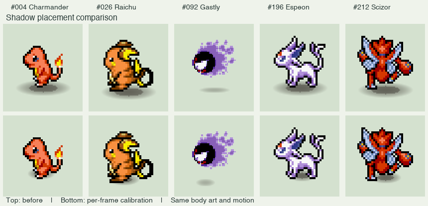

# 精灵影子定位

当前 64 种精灵的 1,597 个 PMD 待机、行走和睡眠帧均包含独立的影子参数。
这些帧使用 1,581 个不同的源 PNG；迷你龙、哈克龙的部分动作复用同一个 PNG。
游戏继续绘制柔边椭圆，不打包影子位图。



## 素材来源与校准

参考 [SpriteCollab](https://github.com/PMDCollab/SpriteCollab)，固定版本
`350b68033bed372c630a1384dbaef86f42f84fb8`。
导入器读取 `AnimData.xml` 的 `ShadowSize`，以及 Idle、Walk、Sleep 的
`*-Anim.png` 和 `*-Shadow.png`。白点提供中心，绿、红、蓝区域分别提供
小、中、大椭圆的范围。

项目的 PSD 素材已经裁切、居中和缩放，因此不能直接使用网站坐标。
`tools/import_pmd_shadow_metadata.py` 按方向比较不透明轮廓，在匹配的帧上
换算中心和半径。颜色只用于轮廓相同时的选择，以兼容调色板差异。
轮廓交并比低于 0.90 的 133 个源帧已对照本地拼图人工复核，校准值保存在
`origin_asset/pmd_shadow_overrides.json`。这是本地素材的校准，不宣称与网站
更新后的图像逐像素一致。

最终数据为 `origin_asset/pmd_shadow_metadata.json`，每项包含源 PNG 的 SHA-256、
参考动作/方向/帧、匹配度，以及画布坐标下的 `[centerX, centerY, radiusX, radiusY]`。
更换 PNG 后，生成器会拒绝沿用旧校准。

使用固定版本的 SpriteCollab `sprite/` 目录重新导入：

```sh
python3 tools/import_pmd_shadow_metadata.py /path/to/SpriteCollab/sprite
python3 tools/generate_pokemon_sprites.py
```

普通重新生成完全离线，不需要下载参考素材。调整本地复核值后，先重新导入再生成。
新增精灵或修改图片时应重新检查低匹配帧；人工校准文件同样通过 SHA-256 防止误用。

## 绘制与格式

- `.smonsp` 升级到 v3：每帧记录从 20 字节变为 24 字节，追加 4 字节参数。
  文件头、压缩方式、CRC、像素及 SpriteKind 编号保持原规则。
- 新固件同时读取 v2 和 v3。v2 使用旧地面锚点作为回退；旧固件不能读取 v3。
- `frameGroundOffsetY()` 继续表示原有的可见底边，用于角色位置、碰撞、深度等。
  新的 `frameShadow()` 与 `PokemonShadow::atGround()` 只决定影子。
- 水平镜像按 `width - 1 - centerX` 处理。角色跳跃、悬浮时只抬升身体。
- StickS3 主宠、伙伴及探索角色，以及 AMOLED V1/V2 的居家、探索角色和陆地/
  空中生态精灵使用这些参数。水面精灵继续使用水波表现。
- AMOLED 的探索脏区和植被重绘范围包含校准后的整个影子，避免移动后残影。
- 上机更新时应同时更新应用固件和资源分区；存档格式不变。

## 资源实测

以下比较使用同一工作区的修改前构建，AMOLED 为 lite 配置：

| 项目 | 修改前 | 修改后 | 增加 |
| --- | ---: | ---: | ---: |
| 64 个压缩精灵包 | 504,924 B | 507,971 B | 3,047 B |
| 未压缩精灵数据 | 1,703,412 B | 1,710,824 B | 7,412 B |
| StickS3 应用 bin | 1,378,560 B | 1,379,168 B | 608 B |
| AMOLED V1 应用 bin | 1,390,112 B | 1,390,976 B | 864 B |
| AMOLED V2 应用 bin | 1,710,896 B | 1,711,696 B | 800 B |

非 PMD 帧也保留统一的 4 字节字段（置零），所以未压缩开销是全部 1,853 帧乘 4。
运行时帧结构从 24 字节增至 28 字节；另有解压数据中的 4 字节，因此每个已缓存帧
多用 8 字节。最大的两种精灵同时缓存增加 864 B；42 个缓存槽装入帧数最多的精灵
时增加 10,448 B。源 JSON 和人工校准记录不进入设备资源包。
文件系统镜像大小由分区固定，精灵包的实际内容增量如上。

## 验证

- 精灵生成器：18 项通过，包括所有 PMD 帧覆盖、源哈希及 v3 参数往返。
- 原生 AMOLED 渲染：62 项通过，包括影子接点、左右方向、身体跳跃、v2 兼容，
  以及全帧与局部渲染像素一致。
- 房间编辑器资源读取：5 项通过，支持 v1/v2/v3。
- 探索界面检查 18 项、架构检查 13 项通过。
- StickS3、AMOLED V1 lite、AMOLED V2 lite 构建通过。
- 未烧录，尚需真机观察不同地板背景下的阴影浓度与动作效果。
