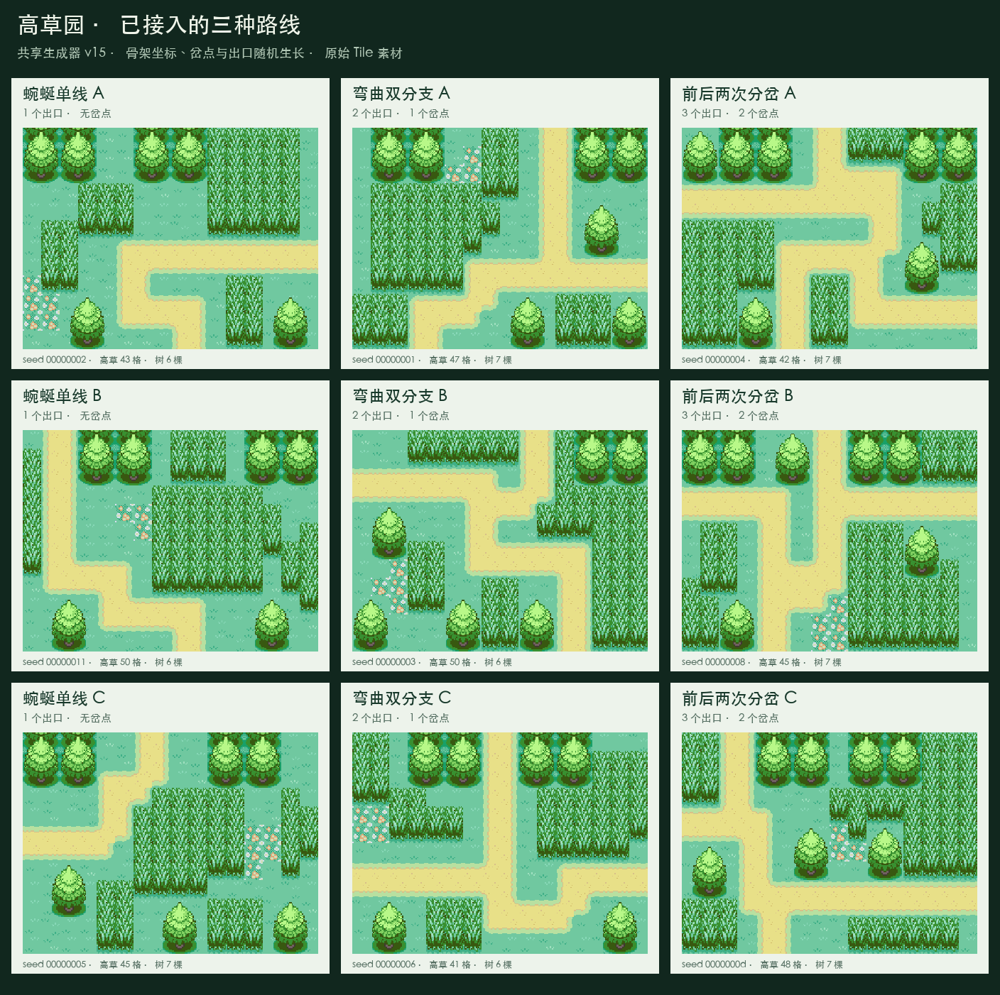
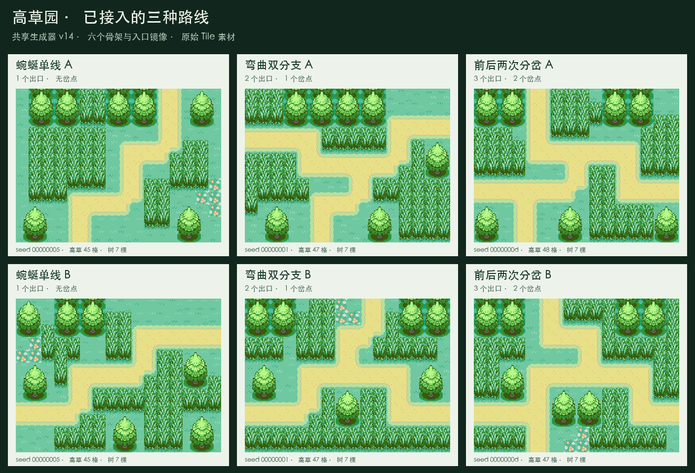
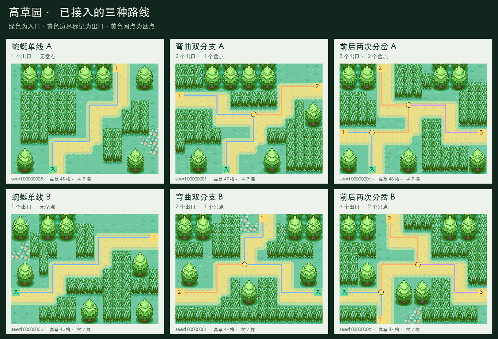

# 高草园素材组合与生成规则

采用“高草作主景、顶部连续树林、完整独立树、蜿蜒路线与可变出口”的方案。
高草园按种子生成骨架坐标，探索沿选定路径自动移动，遇敌继续按区域和路线步数触发。

## 验收规则

- 生成高草园时，地图保持 16×12 格、一入口、1–3 个出口、两格宽道路。
- 放置高草时，草根格在地面层使用 Outside `399`，上方一格在上层使用 `391`。
  相邻排通过不同图层重叠；草尖伸出部分也必须避开道路、树和地图边界。
- 高草由一片主草丛和若干小草丛构成；优先保留约 40–50 个草根格，
  受随机路线空间约束时以完整素材和路线通畅为先。
- 连续林木的开口树冠只能连接地图外的上方树林，组合最上行必须位于地图第 0 行。
  禁止用于左右边界、底部边界或地图内部；其他位置使用完整独立树。
  顶部空间不足时以独立树补足，优先保证道路净空与素材完整。
- 树在顶部集中、小空地少量点缀；入口、出口、岔口与路线不得被树覆盖。
- 按精灵实际脚点与植物地面深度确定遮挡；植物始终绘制在底图中，
  在每个精灵绘制后仅恢复该精灵范围内且位于其前方的植物，避免覆盖后来绘制的近处精灵。
- C++ 与 Python 在相同种子、入口和区域下必须生成相同指纹。
- StickS3 与 AMOLED V1/V2 使用相同素材与生成规则，保留运行时 Tile atlas。

## 路线规则

| 类型 | 出口数 | 岔点数 | 生成权重 |
| --- | --- | --- | --- |
| 蜿蜒单线 | 1 | 0 | 30% |
| 弯曲双分支 | 2 | 1 | 50% |
| 前后两次分岔 | 3 | 2 | 20% |

v15 先按权重选结构，再随机生长主路和分支。入口坐标、主路横向偏移次数、
每段长度、转弯方向、岔点位置、分支弯道和出口坐标均参与生成，不使用固定骨架坐标表。
主路先向地图内部推进，再侧向绕行；主路通常有 2–5 次转弯，分支可直达边界或弯折。
两次分岔时，第二岔点沿主路位于第一岔点之后至少四步，路径数组先放第一条分支，
再放两条继续经过第二岔点的路线。不生成环路或四向十字口。

纵向入口在 16×12 的坐标范围生成；横向入口先在 12×16 范围生成再转置。
反射会保留两格道路的左上锚点，并重新填充入口/出口附近的步点；
植被始终按实际地图顶部放置，不随道路反射。

每张地图最多尝试 192 个生长候选，每个候选检查树状中心线、边界开口、
道路加宽后的意外粘连与植被空间。不合格候选不会进入运行时地图。
预算用尽后，最多尝试 32 个紧凑构造候选；兜底路线仍从种子抽取弯道和端点坐标，
保留已经选定的结构。固定长度数组与位掩码限制内存开销，生成不进入逐帧渲染路径。
正式固件与 Python 共用 XorShift32 调用顺序，具体种子画面与采用 Python Random 的
提案预览不同。相同种子、入口、区域可复现同一地图，不同种子也可能生成相似骨架。

保持现有自动选路，不新增岔点操作面板。

`PATH_COUNT=2` 继续服务原有区域，新增 `MAX_PATH_COUNT=3` 作为路径容量；
高草园使用实际 `pathCount`。两端路线选择、头目候选数组、StickS3 地图衔接均支持第三条路线。
`junction` 表示第一个岔点，单线路线使用入口作为兼容占位；JSON 中的 `junctions`
列出实际所有岔点。没有修改 GameState 或存档格式。

植被优先留开树间空隙；紧凑路线可让完整独立树相邻，并适当降低草量目标至 40 格。
草尖、草根、树体与道路始终分离，保留草丛生成空间。

## 素材与分层

原图为 `Graphics/Tilesets/Outside.png`，每格 32×32，运行时每格 26×26。
以下为 RPG Maker XP 的源 Tile ID，不是 GameAssets 枚举编号。

| 组合 | 从上到下的 Tile 行 | 用法 |
| --- | --- | --- |
| 高草 | `391` / `399` | 草根 `399` 在 Layer 0，草尖 `391` 在 Layer 1、向上偏移一格 |
| 连续树林 | `800,801` / `808,809` / `816,817` | 仅顶部边界，最上行固定在第 0 行 |
| 独立树 2×3 | `804,805` / `812,813` / `820,821` | 树心对齐两列中线 |
| 独立树 3×3 | `824,825,826` / `832,833,834` / `840,841,842` | 树心对齐中心格 |

两种独立树的有效画面宽度相同，主要区别是格子对齐。红叉占位格不导出。
树体放在 Layer 1；植物深度由草根或树的最下行确定，见共享的
`src/game/ExploreTileSemantics.h`。

## 实现与验证

- 生成：`src/game/ExploreMapGenerator.cpp` 与 `tools/generate_runtime_tile_map.py`。
- 资源：`tools/generate_game_assets.py` 与 `src/assets/GameAssets.h/.cpp`；
  新 Kind 追加在尾部，保留旧资源编号。
- 表现：StickS3 的 `ExploreScene` 与 AMOLED 的共享探索渲染。
- 验证：多种子和四种入口的路线净空、成套素材、草丛分布和 C++/Python 指纹；
  资源编号与包限制；前后精灵的植物遮挡；受影响的三个固件构建。

任务进度：

- [x] 高草园专用生成与多种子验证。
- [x] 补齐高草和独立树资源、重生成地图包。
- [x] 接入两种界面的植物深度遮挡。
- [x] 导出实际生成预览、完成测试与固件构建。

v15 随机骨架验证（2026-10-14）：

- 生成器 18 项测试通过，新增同类坐标变化、种子复现、强制兜底与两格道路粘连回归。
  六区域 504 组指纹及冰洞 72 组层级变体仍一致。
- 额外检查 512 个连续种子及 4 个边界种子，覆盖四种入口，共 2,064 张高草园地图。
  C++/Python 指纹全部一致，草量 40–50 格、树量 6–7 棵，连续林木仅贴顶部。
  四个入口方向分别观察到 507/502/504/501 个不同骨架；45 张使用随机坐标的紧凑兜底，
  此批样本最多尝试 193 次。详情见实际预览目录的 `audit.json`。
- AMOLED 原生应用与渲染 41 项通过，包括第三路线选择、头目与下一张地图衔接；
  探索步骤、探索界面、架构边界回归通过。
- StickS3 release、AMOLED V1/V2 Lite 构建通过，未刷机、未完成实机验收。
- 复用现有 Tile atlas，没有修改 GameState、存档格式或资源包。

v15 实际生成的三类九张地图（前两行底部入口，第三行左右入口）：

以下保留 v14 素材和模板路线接入阶段的验证记录（2026-10-14）：

- 生成算法已升级至 v14，接入三种路线；保留 v13 的连续林木仅贴顶部规则。
- 生成器 15 项测试通过，包括 70 种子×4 入口（含原预览四组种子及紧凑布局回归种子）的配对、
  成套树块、连续林木仅贴顶部、路线净空与草丛分布；另外检查实际出口数、
  岔点先后顺序、无环、步长、转弯、地图边界和四种入口的完整骨架覆盖。
  样本中每张地图有 40–50 个草根格、6–7 棵树、3–4 个草丛。
- 504 组 C++/Python 六区域指纹对照及 72 组冰洞层级变体通过。
- 额外检查 512 种子×4 入口的 2,048 张高草园地图，草量均为 40–50 格，树木均为 6–7 棵。
  此批样例中单出口 604 张、双出口 1,004 张、三出口 440 张。
- 资源测试 17 项通过。新增 17 个 Tile，原有 355 个 Kind 编号保持不变。
  地图包为 258 帧、23,625 字节；同步帧上限为 272，其他资源限制未调整。
- AMOLED 完整渲染与应用测试 41 项、探索界面测试 18 项、探索步骤测试 14 项通过；
  新增用例覆盖 1–3 条路线、第三条路线的自动选择及头目放置、从第三出口衔接下一张地图。
  植被专项用例覆盖
  草尖和三行树体深度、前后角色、三角色排序、头目巡逻位移、同深度顺序、
  完整帧与脏区一致性、地图缓存可用与不可用两种路径。
- 架构边界 12 项、渲染调度 2 项、冰洞滑行 2 项回归通过。
- StickS3 release、AMOLED V1/V2 release（Lite，关闭 ESP-Claw）构建通过，
  本次复用已有 Tile atlas，没有新增资源帧或修改资源包。
- 实际地图及角色遮挡导出图已检查。尚未刷机，未完成三端实机验收。

v14 历史三类六张地图预览（当前 `tools/generate_tall_grass_route_preview.py` 默认导出 v15）：

